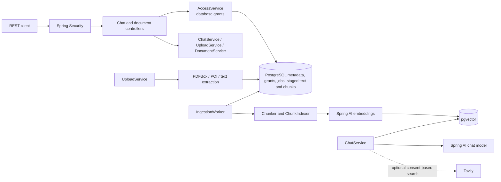

# Enterprise Knowledge Assistant — Backend

The Enterprise Knowledge Assistant (EKA) backend is a Java/Spring REST API for uploading technical documents, indexing their text as vectors, and answering questions using authorized internal evidence. It also provides document lifecycle APIs and database-backed collection permissions.

The implemented backend uses Spring AI with Ollama or OpenAI for chat and embeddings, PostgreSQL with pgvector for persistence and similarity search, and optional Corrective RAG (CRAG) and Tavily web search. This README describes this repository only; the user interface and product specifications live in separate repositories.

## Current implementation status

| Area | Status |
|---|---|
| Upload and ingestion | Implemented: PDF, DOCX, TXT, and Markdown upload; extraction; durable queued jobs; chunking; embeddings; and vector indexing. |
| Document management | Implemented: permission-scoped listing, status lookup, re-index, soft delete, and scheduled purge. |
| Question answering | Implemented: collection-scoped cosine similarity retrieval, metadata filters, evidence-bounded prompting, abstention when no evidence is available, and citations built from trusted database metadata. |
| Authentication and authorization | Implemented: local-profile HTTP Basic or OIDC JWT resource-server authentication, with database-backed roles and collection grants. |
| Corrective RAG | Implemented but disabled by default: passage evaluation, one query rewrite/retrieval retry, evidence refinement, and optional consent-based Tavily search. |
| Quality evaluation | A Node.js evaluation runner and unit/integration tests exist. No representative, human-labelled enterprise corpus or provider cost reporting is included. |

This is not a claim of production readiness. There is no API for administrators to create users, collections, or grants; local setup uses SQL seed data. No explicit CORS configuration, chat history, blended keyword/vector search, reranker, or model usage/cost accounting was found. Retrieval and generated answers still require human verification.

## Key features

- Uploads PDF, DOCX, TXT, and Markdown files (10 MiB maximum by default), checks file signatures for PDF/DOCX, extracts text, and rejects duplicate content within a collection.
- Stores extracted segments and durable ingestion job state in PostgreSQL; original uploads are processed from a temporary file and are not retained.
- Chunks extracted text using overlapping whitespace-delimited word windows (default size 800, overlap 100), creates embeddings, and stores vectors in the provider-specific table.
- Searches indexed chunks using pgvector cosine distance and applies the caller's collection grants and optional version, document type, and tag filters.
- Grounds chat responses in retrieved passages and returns citation metadata from the backend rather than model-generated identifiers.
- Soft-deletes documents immediately from access and retrieval, then purges their database content after the configured retention period (7 days by default).
- Carries a validated `X-Correlation-Id` through responses and logs; chat responses include total and retrieval duration in milliseconds.

## Technology stack

| Component | Repository version / implementation |
|---|---|
| Language | Java 21 toolchain |
| Framework | Spring Boot 4.1.1 |
| Build | Gradle 9.7.1 wrapper |
| AI integration | Spring AI 2.0.1; Ollama and OpenAI chat/embedding starters |
| Persistence | PostgreSQL, Spring JDBC (`JdbcClient`), Flyway |
| Vector search | pgvector; provider-specific vector tables with HNSW cosine indexes |
| Document extraction | Apache PDFBox 3.0.8; Apache POI OOXML 5.5.1 |
| Security | Spring Security HTTP Basic for local profile; OAuth2 Resource Server JWT for OIDC |
| Tests | JUnit Platform, Spring Boot test support, Spring Security test, Testcontainers |
| Optional web search | Tavily Search API |

Chat and embedding providers are selected independently. Local defaults are Ollama for both; the `deployed` profile defaults to OpenAI for both.

## Architecture

The application uses Spring MVC controllers, service classes, and explicit SQL through Spring JDBC. There are no JPA entities or Spring Data repositories in the implemented persistence path.



### Request and ingestion flow

1. A document upload checks the caller's `MANAGE` permission for the target collection, validates metadata, size, extension and supported file signature, calculates a SHA-256 checksum, and extracts text.
2. The service persists document metadata, extracted segments, and a queued ingestion job in PostgreSQL and returns `202 Accepted`. The uploaded bytes are not retained; extracted segments are staged in the database.
3. The scheduled worker claims queued jobs using PostgreSQL row locking, chunks the staged text, obtains embeddings, and transactionally replaces the document's chunk and vector records. The document status becomes `INDEXED` or `FAILED`; retry and stale-job recovery are persisted.
4. A chat request intersects any requested collection IDs with the caller's readable collections, embeds the question, and searches only indexed documents in that permitted scope. Optional metadata filters narrow the search.
5. In the default path, results meeting the similarity threshold are included in a bounded prompt. In CRAG mode, the service evaluates passages, can rewrite the query once and retry retrieval, then refines evidence. If CRAG stages fail, it falls back to baseline threshold-selected evidence. Optional Tavily lookup is only attempted after an unsuccessful internal retry when both server configuration and per-request consent allow it.
6. The answer and citations are returned. Without usable evidence the service abstains, returning `insufficientEvidence: true`.

The configured chunk “token” size and answer context budget use whitespace-separated words as a provider-independent approximation, not the tokenizer of the selected model.

## Repository structure

```text
.
├── build.gradle
├── compose.yaml
├── Dockerfile
├── evaluation/
│   ├── evaluate.mjs
│   ├── build-dataset.mjs
│   └── README.md
├── gradle/wrapper/
├── scripts/start-local.sh
└── src/
    ├── main/java/org/enterpriseknowledgeassitance/
    │   ├── api/          # Request/response records and route constants
    │   ├── chat/         # Chat orchestration, CRAG and external search
    │   ├── config/       # Typed settings and AI provider validation
    │   ├── documents/    # Upload, status, deletion, audit and purge
    │   ├── extraction/   # PDF, DOCX, text and Markdown extraction
    │   ├── ingestion/    # Durable worker, chunking, embedding and search
    │   ├── security/     # Authentication and database-backed access checks
    │   └── web/          # Error responses and correlation IDs
    ├── main/resources/
    │   ├── application*.properties
    │   └── db/migration/ # Flyway V1–V6; local-dev.sql seed
    └── test/java/        # Unit, integration, API, database and security tests
```

## Prerequisites

- JDK 21 (the Gradle Java toolchain is configured for 21) and the included Gradle wrapper.
- Docker with Compose for PostgreSQL and for Testcontainers-based tests.
- Ollama with the selected chat and embedding models, or an OpenAI API key.
- `psql` for the optional local identity/collection seed.

The supplied Compose database uses `pgvector/pgvector:pg18`; Testcontainers tests use `pgvector/pgvector:pg17`. Migrations require the PostgreSQL `vector` and `pgcrypto` extensions. The repository does not establish a minimum PostgreSQL version beyond those configurations.

## Configuration

`application.properties` loads an optional root `.env` file and defaults to the `local` profile. The `.env` file is git-ignored; never commit real passwords or provider keys. `.env.example` lists the local variables used by the setup. The most relevant environment settings are:

| Variable | Required? | Purpose and default |
|---|---|---|
| `EKA_DB_NAME` | Optional (Compose only) | Database name created by Compose; default `eka`. If changed, set `EKA_DB_URL` to use the same database. |
| `EKA_DB_URL` | Optional | JDBC URL; default is `jdbc:postgresql://localhost:5433/eka` (the port follows `EKA_DB_PORT`). Set it explicitly if the database name/host differs from this default. |
| `EKA_DB_PORT` | Optional | Host port for the Compose database; default `5433`. |
| `EKA_DB_USER` | Optional | PostgreSQL user; default `postgres`. Compose uses it as the initial database user too. |
| `EKA_DB_MIGRATION_USER` | Optional | Flyway migration user; defaults to `EKA_DB_USER` (then `postgres`). |
| `POSTGRES_PASSWORD` | Required by Compose | Password for the PostgreSQL user. Use a local secret, not the example value. |
| `EKA_CHAT_PROVIDER`, `EKA_EMBEDDING_PROVIDER` | Optional | Select `ollama` or `openai` independently; both default to `ollama`. |
| `EKA_CHAT_MODEL`, `EKA_EMBEDDING_MODEL` | Optional | Default `llama3.2:latest` and `nomic-embed-text` for Ollama. In the deployed profile defaults are `gpt-4o-mini` and `text-embedding-3-small`. |
| `EKA_EMBEDDING_DIMENSIONS`, `EKA_VECTOR_TABLE` | Optional, must match | Default `768` and `vector_store_ollama`; OpenAI's configured table requires `1536` and `vector_store_openai`. Startup validation rejects unsupported pairings. |
| `OLLAMA_BASE_URL` | Optional | Ollama endpoint; default `http://localhost:11434`. |
| `OPENAI_API_KEY` | Required if OpenAI selected | Server-side OpenAI credential. It is not required for Ollama-only operation. |
| `EKA_LOCAL_USER`, `EKA_LOCAL_USER_PASSWORD` | Required for usable local Basic login | Local-profile in-memory HTTP Basic credentials. The example uses `dev`; replace its example password. The matching database subject and collection grant must also be seeded. |
| `SPRING_PROFILES_ACTIVE` | Optional | Choose profile(s), e.g. `local,oidc` or `deployed`. The default is `local`; `local` and `deployed` cannot be active together. |
| `SERVER_PORT` | Optional | Spring Boot server port; default `8080`. |
| `EKA_OIDC_ISSUER_URI` | Required for OIDC | JWT issuer URI. `application-oidc.properties` supplies a localhost Keycloak example default, but a real issuer must be reachable and match the token issuer. |
| `EKA_OIDC_AUDIENCE` | Required for OIDC | Expected API audience; every accepted access token must contain this value in `aud`. Configure the Keycloak client/audience mapper to issue it. |
| `EKA_RETRIEVAL_TOP_K` | Optional | Retrieval count; default `10`. |
| `EKA_RETRIEVAL_SIMILARITY_THRESHOLD` | Optional | Minimum cosine-similarity score in the normal retrieval path; default `0.30`. |
| `EKA_RETRIEVAL_DIAGNOSTIC_CANDIDATE_COUNT` | Optional | Candidate count logged for retrieval diagnostics; default `10`. |
| `EKA_CRAG_ENABLED` | Optional | Enables corrective retrieval evaluation/refinement; default `false`. |
| `EKA_WEB_SEARCH_ENABLED`, `TAVILY_API_KEY` | Optional | Enable server-side Tavily search and configure its key. Search still requires `allowExternalSearch: true` on the individual chat request. |
| `EKA_WEB_SEARCH_TIMEOUT` | Optional | Tavily timeout; default `8s`. |
| `EKA_WORKER_ENABLED` | Optional | Enable ingestion worker; default `true`. |
| `EKA_PURGE_ENABLED` | Optional | Enable soft-delete purge scheduler; default `true`. |

Other important defaults configured in `application.properties` include a 10 MiB upload cap, extensions `pdf,docx,txt,md`, 800/100 chunk size/overlap, 4,000-word approximate answer context budget, 12,000,000 extracted characters, 1,000 PDF pages, and seven-day soft-delete retention. These are Spring properties under the `eka.*` prefix and can be overridden with Spring's standard property sources.

The `deployed` profile selects OpenAI and requires `OPENAI_API_KEY`, `EKA_OIDC_ISSUER_URI`, and `EKA_OIDC_AUDIENCE`. Do not use the local Basic profile or development credentials in a shared or deployed environment.

## Local setup

1. Clone the repository and create a local environment file:

   ```bash
   git clone https://github.com/kumarpramodlohar/enterprise-knowledge-assistant-backend.git
   cd enterprise-knowledge-assistant-backend
   cp .env.example .env
   ```

   Edit `.env` and set a unique local `POSTGRES_PASSWORD` and `EKA_LOCAL_USER_PASSWORD`. The checked-in example values are for local development only.

2. Start PostgreSQL with pgvector:

   ```bash
   docker compose up -d --wait postgres
   docker compose ps
   ```

   Compose publishes PostgreSQL on port `5433` by default. Flyway applies the schema migrations automatically when the backend starts.

3. Start the selected AI provider. For the default Ollama models:

   ```bash
   ollama pull llama3.2:latest
   ollama pull nomic-embed-text
   ```

   For OpenAI, choose `openai` for the required provider setting(s) and set `OPENAI_API_KEY`. Keep the embedding model, dimensions, and vector table aligned as described above.

4. Seed the local user and a collection grant. The Basic-auth username is held in memory; this SQL creates the matching application identity and grants `MANAGE` on `General`:

   ```bash
   PGPASSWORD='<your-POSTGRES_PASSWORD>' psql \
     -h localhost -p 5433 -U eka_app -d eka \
     -v ON_ERROR_STOP=1 \
     -v local_subject=dev \
     -v collection_name=General \
     -f src/main/resources/db/seed/local-dev.sql
   ```

   Change `-U`, `local_subject`, and `collection_name` to match `.env`. The SQL seed does not create or set the Basic password. It only creates the collection, database identity and grant. With the `.env.example` database settings, the database user is `eka_app`.

5. Start the backend:

   ```bash
   ./gradlew bootRun
   ```

   The application listens on port `8080` by default. Verify the public health endpoint:

   ```bash
   curl -i http://localhost:8080/actuator/health
   ```

   The configured Actuator endpoint reports health; the startup log reports selected AI provider/model and vector configuration, not provider reachability or model availability.

To use Keycloak locally instead of Basic authentication, run with `SPRING_PROFILES_ACTIVE=local,oidc` and set `EKA_OIDC_ISSUER_URI`. HTTP Basic is disabled whenever the `oidc` profile is active. The first valid JWT subject is provisioned as a `MEMBER` with no collection grants; grant access out of band using database administration.

## API

All application endpoints require authentication. The only public endpoint is `GET /actuator/health` (including health probe paths). Use HTTP Basic with the `local` profile or `Authorization: Bearer <JWT>` with an OIDC profile.

| Method and path | Purpose | Successful response |
|---|---|---|
| `POST /api/v1/documents` | Multipart upload; requires collection `MANAGE` | `202 Accepted`, `UploadAcceptedResponse` |
| `GET /api/v1/documents` | List readable documents with filters and pagination | `200 OK`, `DocumentPage` |
| `GET /api/v1/documents/{id}` | Read document status/metadata | `200 OK`, `DocumentResponse` |
| `POST /api/v1/documents/{id}/reindex` | Queue an indexed or failed document again; requires `MANAGE` | `202 Accepted`, `DocumentResponse` |
| `DELETE /api/v1/documents/{id}` | Soft-delete document; requires `MANAGE` | `204 No Content` |
| `POST /api/v1/chat/query` | Ask a question against readable collections | `200 OK`, `ChatQueryResponse` |
| `GET /api/v1/me` | Return subject, database role, readable and manageable collection IDs | `200 OK` |
| `GET /actuator/health` | Health endpoint | `200 OK` when healthy |

Inaccessible or deleted collections/documents are hidden as `404`. Authentication failures return `401`; authorization failures from the security filter chain return `403`. API errors use `{ "code", "message", "correlationId" }`; validation errors are `400`. Upload errors include `413` for size/content limits, `415` for unsupported types, `422` for unreadable files, and `409` for duplicate content.

### Upload a document

`file` and `collectionId` are required multipart fields. `version`, `documentType`, and repeated `tags` are optional.

```bash
curl -u 'dev:<local-password>' \
  -F 'collectionId=<collection-uuid>' \
  -F 'file=@./handbook.pdf;type=application/pdf' \
  -F 'version=v1' \
  -F 'documentType=handbook' \
  -F 'tags=engineering' \
  -F 'tags=onboarding' \
  http://localhost:8080/api/v1/documents
```

Example `202` response:

```json
{
  "documentId": "c1b02b47-3e17-4ca1-98c9-f1963dd52d5c",
  "status": "QUEUED",
  "statusUrl": "/api/v1/documents/c1b02b47-3e17-4ca1-98c9-f1963dd52d5c"
}
```

Poll `statusUrl` until status is `INDEXED` or `FAILED`. The status response includes the stable `failureReason` when processing fails.

### List and inspect documents

`GET /api/v1/documents` accepts optional query parameters `collectionId`, `status`, `documentType`, `tag`, `page`, and `size`. Page defaults to `0`; size defaults to `20` and is limited to `100`. Collection results are always scoped to the caller's readable grants.

```bash
curl -u 'dev:<local-password>' \
  'http://localhost:8080/api/v1/documents?status=INDEXED&tag=engineering&page=0&size=20'
```

`DocumentPage` has `items`, `page`, `size`, and `totalItems`. Each `DocumentResponse` includes `id`, `collectionId`, `fileName`, `contentType`, `sizeBytes`, `status`, `failureReason`, `version`, `documentType`, `tags`, `createdAt`, and `updatedAt`.

### Ask a question

The question is required, non-blank, and limited to 2,000 characters. Filters only narrow the caller's scope. Tags match when any requested tag overlaps. `allowExternalSearch` defaults to `false`.

```bash
curl -u 'dev:<local-password>' \
  -H 'Content-Type: application/json' \
  -d '{
    "question": "What is the equipment return policy?",
    "filters": {
      "collectionIds": ["<collection-uuid>"],
      "version": "v1",
      "documentType": "policy",
      "tags": ["operations"]
    },
    "allowExternalSearch": false
  }' \
  http://localhost:8080/api/v1/chat/query
```

Example response shape:

```json
{
  "answer": "The policy says ...",
  "insufficientEvidence": false,
  "citations": [
    {
      "documentId": "c1b02b47-3e17-4ca1-98c9-f1963dd52d5c",
      "fileName": "handbook.pdf",
      "chunkId": "5f864a57-66b1-42b8-8680-e40c9387f388",
      "pageNumber": 12,
      "section": "Returns",
      "snippet": "Equipment must be returned ...",
      "sourceType": "INTERNAL",
      "title": null,
      "url": null
    }
  ],
  "correlationId": "abc-123",
  "timingMs": 420,
  "retrievalMs": 65
}
```

When evidence is insufficient, `answer` is null (normally omitted from JSON), `insufficientEvidence` is `true`, and `citations` is empty. With external search, citations use `sourceType: "EXTERNAL"` and contain a title, HTTPS URL, and snippet.

### Current user

```bash
curl -u 'dev:<local-password>' http://localhost:8080/api/v1/me
```

The response contains the authenticated `subject`, database `role`, `readableCollectionIds`, and `manageableCollectionIds`. The role is `ADMIN`, `MEMBER`, or `NONE`.

## Database and migrations

Flyway is enabled at startup. The checked-in migrations create:

- `V1`: `vector` and `pgcrypto` extensions.
- `V2`: collections, documents, ingestion jobs, and application-owned chunk metadata.
- `V3`: Ollama (`vector(768)`) and OpenAI (`vector(1536)`) vector tables with HNSW cosine indexes.
- `V4`: application identities and collection grants.
- `V5`: chunk offsets and staged extracted-text segments.
- `V6`: ingestion retry timing, purge lifecycle, and content-free document audit records.

Use the Compose PostgreSQL service for local development. No manual schema initialization command is needed; startup runs Flyway. The `local-dev.sql` seed is separate from migrations and is only for local identity/collection setup.

## Running tests and evaluation

Run the Gradle test suite:

```bash
./gradlew test
```

Integration tests use Testcontainers with `pgvector/pgvector:pg17`, so Docker must be running. Test sources include migration, document upload/management, ingestion/indexing, API contract, security, CRAG, provider configuration, and extraction tests. Tests use fake embeddings and mocked model calls where applicable; they do not establish answer quality against a representative enterprise corpus.

Other available Gradle commands:

```bash
./gradlew bootRun
./gradlew bootJar
```

An optional Node.js evaluation runner is documented in [evaluation/README.md](evaluation/README.md). It requires a separately controlled evaluation dataset and a running backend; the checked-in evaluation tooling does not provide production quality metrics or cost estimates by itself.

## Docker

`compose.yaml` starts PostgreSQL only:

```bash
cp .env.example .env
# Set a local POSTGRES_PASSWORD in .env
docker compose up -d --wait postgres
```

The application `Dockerfile` builds a Spring Boot JAR and runtime image for `linux/arm64`. It does not define an application service in Compose. When running the image, provide database, authentication, and AI-provider configuration explicitly and ensure the container can reach those services. The Ollama default `localhost` URL points inside the application container, so a containerized backend needs an Ollama URL reachable from that container.

## AI and retrieval details

- **Extraction:** PDFBox extracts page text and page numbers; Apache POI extracts DOCX body paragraphs and heading section names. TXT and Markdown use the text extractor. Images/OCR and original-file storage were not found.
- **Chunking:** overlapping windows of whitespace-delimited words; default size 800 and overlap 100. Chunk metadata includes index, source page/section where available, and start offset.
- **Embedding and storage:** Spring AI embedding model selection is independent of chat selection. Embeddings are batched (default 32) and checked for expected dimensions. PostgreSQL stores chunk text/metadata and vectors in one provider-specific pgvector table. Changing the embedding provider/model requires indexing against compatible vectors; chat provider changes do not.
- **Retrieval:** cosine similarity, default top-K 10 and threshold 0.30; only indexed, non-deleted documents in granted collections and matching embedding model are eligible. Optional filters include version, document type, and overlapping tags. Candidate scores are logged with correlation ID and IDs, not passage text.
- **Answer generation:** retrieved evidence is XML-escaped, treated as untrusted data in a system prompt, and bounded by a 4,000-word approximate context budget. Model responses are returned with internal citations built from trusted chunk/document records. The model's own citation IDs are not used.
- **Corrective retrieval:** when `EKA_CRAG_ENABLED=true`, the service classifies up to five passages as correct/ambiguous/incorrect, abstains on ambiguous evidence, rewrites and retrieves once for incorrect evidence, and refines selected evidence before generation. CRAG has a 60-second default stage budget. A CRAG-stage exception falls back to threshold-selected baseline evidence.
- **External search:** disabled by default and implemented through Tavily's basic search endpoint. It is only attempted after an internal CRAG retry fails, only when server settings and the per-question `allowExternalSearch` flag are enabled, and only HTTPS results are accepted. External results are separately cited.

The API returns response and retrieval timing. Model token usage, provider costs, query-level answer-quality tracking, hybrid search, and a reranker were not found.

## Security considerations

- Local profile authentication uses stateless HTTP Basic with in-memory credentials. It is development-only.
- OIDC profiles validate bearer JWTs against the configured issuer. New JWT subjects are provisioned as database `MEMBER` identities without collection grants.
- Collection roles/grants are read from PostgreSQL, never from request data. `MANAGE` implies read; `ADMIN` can access all collections. Inaccessible resources resolve as `404` to avoid disclosing their existence.
- File extensions, upload size, filename, metadata, PDF/DOCX signatures, extracted text size, PDF page count, and DOCX ZIP expansion are bounded/validated.
- CSRF is disabled for the stateless API. No explicit CORS policy was found; browser clients running on another origin may need a same-origin proxy or an explicitly configured CORS policy in the deployment.
- Keep database and provider credentials outside source control. The local seed SQL creates a development grant; there is no administrative API for managing users or access.

## Troubleshooting

| Symptom | Check |
|---|---|
| Backend cannot connect to PostgreSQL | Confirm `docker compose ps`, host port (`5433` by default), database/user/password, and that `EKA_DB_URL` matches Compose settings. |
| Flyway fails while creating extensions | Use a PostgreSQL image with pgvector and permission to create `vector` and `pgcrypto`; Compose provides the configured pgvector image. |
| Local login works but document/chat access is empty | The local Basic user is in memory; seed a database `app_users` row and collection grant with the same subject. |
| OpenAI provider fails at startup | Set `OPENAI_API_KEY` when either chat or embedding provider is `openai`; make sure embedding dimensions and vector table match. |
| Ollama calls fail | Start Ollama, check `OLLAMA_BASE_URL`, and confirm the exact chat/embedding model has been pulled. For a containerized backend, `localhost` is not the host Ollama service. |
| Upload is accepted but does not become indexed | Check the ingestion worker is enabled, inspect the document's status/failure reason, and verify embedding provider availability and configured dimensions. |
| No answer or no citations | Check the caller's collection grants, document `INDEXED` status, retrieval filters, and similarity threshold. Responses intentionally abstain if evidence is not eligible. |

## Known limitations and future work

Implemented but opt-in: CRAG and Tavily search. Both are off by default; Tavily also requires per-request consent.

Important current limitations include:

- No application API for creating collections, users, roles, or grants; bootstrap/access administration is out of band.
- No chat history, feedback endpoint, OCR, keyword/hybrid retrieval, or reranking was found.
- The evaluation utility needs an external, representative, human-reviewed dataset; provider cost reporting is explicitly unavailable.
- No explicit CORS policy, production deployment orchestration, or deployment-specific operational/observability stack was found in the repository.
- The runtime default PDF page limit is 1,000. The integration test overrides it to 500 to verify the configured limit and its distinct API error.

The implementation does have query rewriting and corrective evidence evaluation; those should not be described as planned-only capabilities. See [evaluation/README.md](evaluation/README.md) for what the current runner reports and what evaluation inputs remain outstanding.

## Related repositories

- [Product specification](https://github.com/kumarpramodlohar/enterprise-knowledge-assistant-spec) — requirements, architecture decisions, and feature plans; it is not the implementation source for this backend README.
- [Frontend](https://github.com/kumarpramodlohar/enterprise-knowledge-assistant-frontend) — React/TypeScript user interface maintained separately.

## Development workflow and contribution

Use the Gradle wrapper for builds, tests, and local execution. Add or update tests alongside behavior changes; database integration tests use Testcontainers and require Docker. Keep local secrets and evaluation datasets out of commits. No repository-specific contribution guide or CI workflow was found.

## License

No license file or declared license was found in this repository. The intended license has not been specified.
